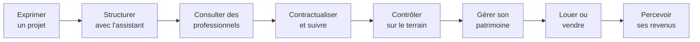
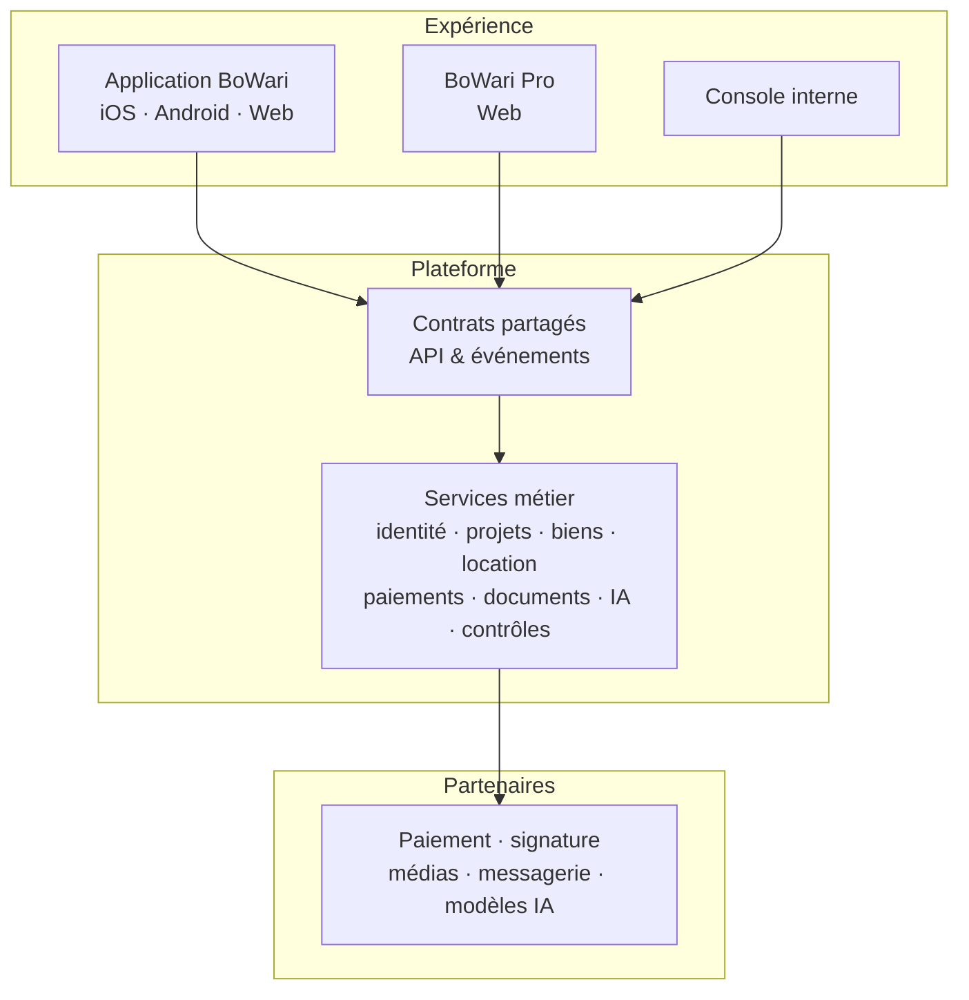

# BoWari

### Concevoir, réaliser et valoriser son immobilier en Afrique, où que l'on vive.

**Une plateforme de GENIUS GROUPS · Premier marché visé : Côte d'Ivoire 🇨🇮**

---

## Notre mission

Suivre un projet immobilier à distance est difficile : les informations sont dispersées, les intervenants nombreux, et il n'est pas toujours simple de savoir ce qui a été convenu, réalisé ou payé.

**BoWari veut permettre à chacun de comprendre qui intervient, ce qui a été fait et quelle décision lui revient** — simplement, depuis son téléphone ou son ordinateur.

## La vision

BoWari a pour ambition de connecter la diaspora africaine, les propriétaires, les particuliers et les professionnels de l'immobilier autour d'un même dossier — de l'idée d'un projet jusqu'aux revenus d'un bien.

Chaque étape du cycle de vie du bien est pensée pour rester lisible : le client suit, vérifie et décide.

## Nos produits

| | Produit | Public | Ce qu'il apporte |
| --- | --- | --- | --- |
| 🏠 | **BoWari** | Diaspora, propriétaires, locataires, particuliers | Projets, recherche de biens, patrimoine, locations, paiements et revenus — iOS, Android et Web, un seul compte pour tous les usages |
| 💼 | **BoWari Pro** | Agences, constructeurs, bureaux d'études, contrôleurs | Opportunités, propositions, projets et suivi des activités professionnelles |

## Les piliers de la plateforme

*Une architecture de services indépendants, chacun responsable de son domaine, qui échangent par des API et des événements documentés.*

## Ce à quoi nous tenons

- **La simplicité.** Chaque écran doit dire où l'on en est et quelle est la prochaine étape.
- **La clarté.** Une estimation n'est pas un devis ; une déclaration n'est pas une vérification ; une annonce n'est pas un acte de propriété. BoWari s'attache à ne pas les confondre.
- **Le rôle des professionnels.** Les missions sont exécutées par des professionnels compétents. La plateforme organise la relation et le suivi ; elle ne se substitue pas à eux.
- **Une assistance IA à sa place.** L'assistant aide à formuler et à comprendre. Ses productions sont identifiées comme telles, et les décisions restent humaines.
- **Le respect des données.** Les documents et informations des utilisateurs sont privés par défaut.

## GENIUS GROUPS

BoWari est un projet de **GENIUS GROUPS**, qui en assure la conception et le développement.

---

Cette organisation héberge le développement de BoWari.
Les dépôts de travail sont privés ; cette page en est la présentation publique.

*Les capacités présentées sont une ambition en construction.*
*Elles seront ouvertes progressivement, à mesure que les conditions nécessaires seront réunies.*

